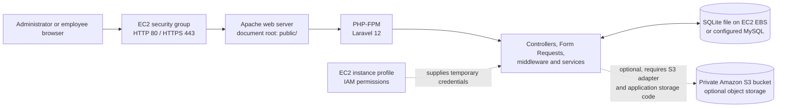
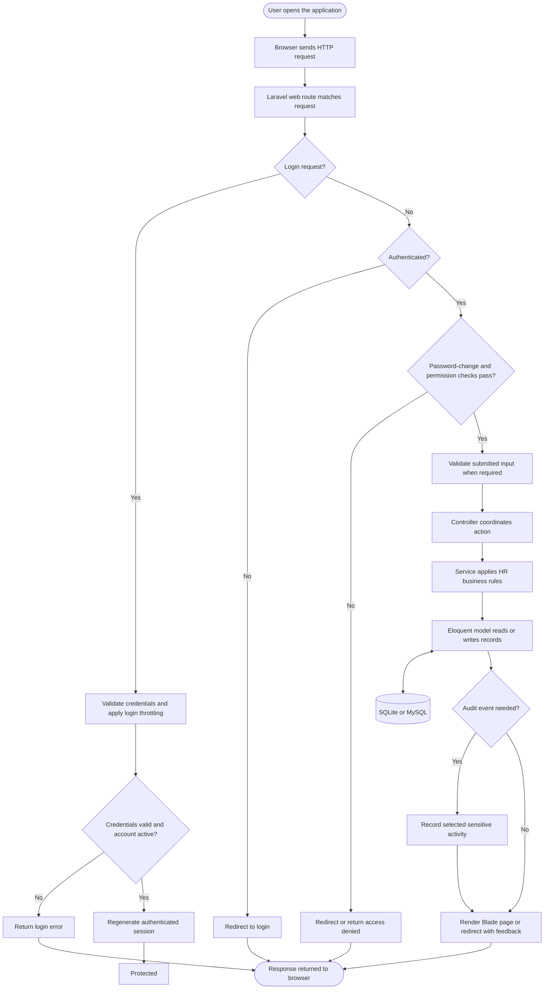

# Smart HR Connect

Smart HR Connect is a Laravel-based human resources management system (HRMS). It provides role- and permission-controlled HR administration and an employee self-service portal.

## What the application does

- **Authentication and access control:** session-based login/logout, password reset, active-account checks, role and permission administration, and protected routes. There is no public registration.
- **Organization and employee administration:** manage departments, designations, employee records, employee accounts, and department managers.
- **Attendance:** record and manage attendance, let employees check in/out, and submit attendance correction requests.
- **Leave:** submit and review leave requests, approve/reject requests, and track leave balances.
- **Payroll:** manage payroll runs and employee payroll records, including calculated net salary and paid-payslip summaries in the employee portal.
- **Employee self-service:** view a personal dashboard, profile, attendance, leave and paid-payslip information, change password, and read company announcements.
- **Administration and oversight:** permission-aware dashboards, read-only HR reports, employee search, company announcements, and Super Admin audit logs with CSV/PDF export.

### Current limitations

- The employee portal displays payslip information; it does not provide a downloadable payslip PDF.
- HR reports are read-only and do not provide CSV/Excel export.
- Attendance rules such as late/half-day thresholds are not configurable, and department-wise attendance summaries are not available.
- The codebase defines an S3 filesystem disk, but currently has no application file-upload flow, S3 storage calls, or AWS S3 Flysystem adapter dependency. Creating a bucket alone does not make the application store files in S3.
- Mail is configured to use Laravel's `log` mailer by default. Configure a real mail provider to deliver password-reset/invitation emails.

## Technology stack

| Area | Technology |
|---|---|
| Backend | PHP 8.2+, Laravel 12 |
| Application pattern | Laravel MVC, Blade server-rendered views, Eloquent ORM |
| Authorization | Custom role/permission tables and middleware |
| Database | SQLite or MySQL (both supported by Laravel configuration) |
| Frontend | Bootstrap 5.3.3 and Bootstrap Icons, with Tailwind CSS 4 and Vite 6 for compiled assets |
| PDF support | `barryvdh/laravel-dompdf` |
| Tests | PHPUnit 11 and Laravel feature tests |
| AWS deployment described here | Amazon Linux 2023 on EC2; private S3 bucket for optional object storage |

Dependency versions and scripts are defined in [`composer.json`](composer.json) and [`package.json`](package.json); use the checked-in lock files when installing dependencies.

## Architecture



In the simple EC2 setup below, the application and SQLite database are on one EC2 instance; S3 is a separate private object store, not a database or a public website host. The current application does not yet read or write S3 objects.

### Request and business flows

1. A browser request reaches Laravel through Apache and PHP-FPM.
2. Laravel validates input through Form Requests and applies session authentication, password-change, role, and permission middleware.
3. A controller coordinates the request; module services contain business operations; Eloquent reads/writes the configured database.
4. Laravel returns a Blade-rendered page or redirects with feedback. Sensitive model changes and login/logout events are recorded by the audit logging components.

**Employee attendance:** employee signs in → opens the employee portal → checks in → checks out later → the system prevents duplicate daily check-ins and calculates worked minutes → the employee or an authorized administrator reviews the attendance record.

**Leave request:** employee submits a request → authorized HR/manager reviews it → request is approved or rejected → an approved request updates the employee's leave balance.

### Implementation methodology

The application uses a modular, layered Laravel methodology:

1. **Organize around HR domains:** authentication, organization, employees, attendance, leave, payroll, reporting, and administration have distinct routes, controllers, models, and views.
2. **Handle each request at the boundary:** web routes select the controller; middleware checks authentication and access; Form Requests validate user input.
3. **Keep responsibilities separated:** controllers coordinate the request, service classes hold reusable business operations, and Eloquent models/relationships represent persisted data.
4. **Persist and render:** database migrations define the schema, seeders provide role/permission reference data and development fixtures, and Blade renders the server-side response.
5. **Protect and verify workflows:** role/permission middleware protects routes, audit components record selected sensitive changes, and PHPUnit feature tests exercise core HR workflows and authorization.

This describes the implementation structure; it does not claim a particular team process such as Scrum or a specific release cadence.

### Application flow diagram



### Main source folders

| Path | Contents |
|---|---|
| `app/Http/Controllers/` | Authentication, dashboard, employee portal, and admin controllers |
| `app/Http/Requests/` | Request validation and authorization |
| `app/Http/Middleware/` | Permission, Super Admin, and password-change checks |
| `app/Models/` | Eloquent models for users and HR records |
| `app/Services/` | HR business operations, dashboards, reporting, and audit logging |
| `database/migrations/` | Database schema |
| `database/seeders/` | Roles, permissions, leave types, and development/sample data |
| `resources/views/` | Blade pages for authentication, admin, employee, and dashboard |
| `resources/css/`, `resources/js/` | Vite/Tailwind frontend inputs |
| `routes/web.php` | Web routes and route middleware |
| `tests/Feature/` | Authentication, permissions, and HR workflow tests |
| `docs/` | ERD, authentication/authorization, and testing notes |

## Roles and security model

Users receive permissions through roles (`users → roles → permissions`). Permission names follow the `module.action` pattern, such as `employee.view` and `leave.approve`. The built-in roles are Super Admin, HR Manager, Department Manager, and Employee. Super Admin has a permission bypass; regular users are limited by route middleware and their assigned permissions.

The local demo seeder creates an administrator with `admin@example.com` / `Password@12345`; organization and other seeders also create sample users and HR records. **These are development-only credentials/data. Never run the full `DatabaseSeeder` on a production database.** In particular, it can create or reset known-password accounts and insert sample payroll/attendance records.

## Local setup

### Prerequisites

- PHP 8.2 or newer with the extensions required by Laravel (including PDO for your chosen database, OpenSSL, Mbstring, XML, Ctype, Fileinfo, and tokenizer)
- Composer
- Node.js 18+ and npm
- MySQL/MariaDB (for the XAMPP setup below), or SQLite

### Windows with XAMPP and MySQL

1. Start MySQL from the XAMPP Control Panel (Apache is only needed if you use phpMyAdmin through its web interface). Create a database named `hrms_laravel`.
2. In PowerShell, from the project directory, create the environment file:

   ```powershell
   Copy-Item .env.example .env
   ```

3. Edit `.env` and set `DB_CONNECTION=mysql`, `DB_HOST=127.0.0.1`, `DB_PORT=3306`, `DB_DATABASE=hrms_laravel`, and the MySQL username/password for your local XAMPP installation. Keep `APP_ENV=local` and `APP_DEBUG=true` only on your development machine.
4. Install dependencies, generate the local app key, create the schema and development seed data, and compile frontend assets:

   ```powershell
   composer install
   npm ci
   php artisan key:generate
   php artisan migrate --seed
   npm run build
   ```

5. Start the development server and open `http://127.0.0.1:8000`:

   ```powershell
   php artisan serve
   ```

   For live frontend rebuilding during development, run `npm run dev` in a second terminal instead of `npm run build`.

The seeded development login is `admin@example.com` / `Password@12345`. Change it immediately if the database is accessible by anyone else. Seeded sample employees use development-only accounts as well.

### SQLite alternative

Laravel also supports SQLite. Create `database/database.sqlite`, set `DB_CONNECTION=sqlite` and `DB_DATABASE` in `.env` to the absolute path of that file, then run `php artisan migrate --seed`. Do not use `migrate:fresh` against a database whose data must be retained; it drops and recreates tables.

### Useful local commands

```bash
php artisan test
php artisan route:list -v --except-vendor
php artisan about
```

## AWS Free Tier deployment: EC2 and Amazon S3

This is a low-cost learning/small-demo deployment, not a highly available production architecture. AWS Free Tier eligibility, quotas, and pricing depend on account age, region, and current AWS terms; **EC2, EBS, data transfer, S3 storage/requests, and public IPv4 usage can incur charges.** Check the Free Tier/Free plan label in the AWS Console, select eligible options, and set a billing budget/alert before creating resources. Stop or terminate resources and delete unneeded S3 objects when finished.

The steps use **Amazon Linux 2023** as the EC2 AMI. SQLite on the EC2 EBS volume avoids requiring a separate database service for this demo. For real employee/payroll data, use a security-reviewed production architecture, managed database/backups, HTTPS, and appropriate privacy/compliance controls; a single EC2 instance and SQLite are not a resilient HR production setup.

### 1. Create a private S3 bucket and an EC2 IAM role (optional until S3 is integrated)

The current app has no S3 calls. You can still provision the private bucket/role for a future upload feature or deployment artifacts; do not make the bucket public.

1. In **AWS Console → S3 → Create bucket**, choose the same AWS Region you will use for EC2, provide a globally unique bucket name, keep **Block all public access** enabled, and leave ACLs disabled. Keep bucket versioning off for a cost-conscious demo unless you specifically need it.
2. In **AWS Console → IAM → Roles → Create role**, select **AWS service → EC2** as the trusted entity. Add a least-privilege policy for only this bucket. Replace `YOUR_BUCKET_NAME` and, if used, scope object access to the prefix your application will use:

   ```json
   {
     "Version": "2012-10-17",
     "Statement": [
       {
         "Effect": "Allow",
         "Action": ["s3:ListBucket"],
         "Resource": "arn:aws:s3:::YOUR_BUCKET_NAME"
       },
       {
         "Effect": "Allow",
         "Action": ["s3:GetObject", "s3:PutObject", "s3:DeleteObject"],
         "Resource": "arn:aws:s3:::YOUR_BUCKET_NAME/hrms-uploads/*"
       }
     ]
   }
   ```

3. Name the role (for example, `SmartHrEc2S3Role`). Do not create access keys for the application; the EC2 instance profile supplies temporary credentials.

### 2. Launch an Amazon Linux 2023 EC2 instance

1. In **AWS Console → EC2 → Instances → Launch instances**, choose an instance name and select an **Amazon Linux 2023 AMI** (64-bit x86_64 is the simplest match for the commands below).
2. Choose an instance type that the console currently marks eligible for your account/region. Set a small root EBS volume consistent with your Free Tier allowance; remember the database and application files live on this volume.
3. Create or select an SSH key pair and download/store the private key securely.
4. Create a security group with inbound rules:
   - SSH (TCP 22): **My IP** only.
   - HTTP (TCP 80): `0.0.0.0/0` for initial testing.
   - HTTPS (TCP 443): `0.0.0.0/0` only when HTTPS is configured.
   - Do not open database ports such as 3306 to the internet.
5. Under **Advanced details → IAM instance profile**, attach `SmartHrEc2S3Role` if you created it. Review the settings and launch the instance.
6. Wait for the instance status checks to pass. Copy its public IPv4 address. For stable DNS, use a domain and an Elastic IP only after reviewing their costs.

### 3. Connect and install the web runtime

Connect using SSH from the allowed IP as `ec2-user`, or configure the security group for the regional EC2 Instance Connect service before using that Console option. On the instance:

```bash
sudo dnf update -y
sudo dnf install -y httpd git unzip php8.2 php8.2-cli php8.2-fpm \
  php8.2-mbstring php8.2-xml php8.2-pdo php8.2-sqlite3 \
  php8.2-gd php8.2-intl php8.2-zip
```

Amazon Linux 2023 supports multiple PHP versions. These commands select PHP 8.2 to satisfy the project's PHP 8.2+ requirement. If a package name is unavailable in the selected AL2023 release, use `dnf search php8.2` and install the corresponding PHP 8.2 module package.

Install Composer using the current instructions from [getcomposer.org](https://getcomposer.org/download/) and verify its installer checksum. Confirm the runtime:

```bash
php -v
php -m
composer --version
```

### 4. Deploy the application and build its frontend assets

Build the assets on your development machine first, from the project root:

```bash
npm ci
npm run build
```

Deploy the project source and the generated `public/build` directory to the instance. For a public Git repository, for example:

```bash
sudo mkdir -p /var/www/smart-hr-connect
sudo chown ec2-user:apache /var/www/smart-hr-connect
git clone YOUR_REPOSITORY_URL /var/www/smart-hr-connect
```

For a private repository or when not using Git on the instance, upload a release archive using SSH/SCP or S3 and extract it under `/var/www/smart-hr-connect`. Ensure the uploaded release includes `public/build` created above. Do not upload `.env`, local databases, `vendor/`, or development secrets from your workstation.

If you cloned the repository and `public/build` is not included in it, run this from PowerShell in your local project directory (replace the key path and address):

```powershell
scp -i .\path\to\key.pem -r public/build ec2-user@YOUR_EC2_PUBLIC_IPV4:/tmp/
```

Then copy the uploaded build into the app on EC2:

```bash
sudo cp -a /tmp/build /var/www/smart-hr-connect/public/
```

Install production PHP dependencies and create the writable runtime directories:

```bash
cd /var/www/smart-hr-connect
composer install --no-dev --optimize-autoloader --no-interaction
sudo mkdir -p storage/app storage/framework/cache storage/framework/sessions \
  storage/framework/views storage/logs bootstrap/cache
sudo chown -R ec2-user:apache /var/www/smart-hr-connect
sudo chown -R ec2-user:apache storage bootstrap/cache
sudo chmod -R ug+rwX storage bootstrap/cache
```

Create and edit a production `.env` on the instance (for example, `nano .env`; do not copy your local `.env`) and set:

```dotenv
APP_NAME="Smart HR Connect"
APP_ENV=production
APP_DEBUG=false
APP_URL=http://YOUR_EC2_PUBLIC_IPV4
APP_TIMEZONE=UTC

DB_CONNECTION=sqlite
DB_DATABASE=/var/www/smart-hr-connect/storage/app/database.sqlite

SESSION_DRIVER=database
CACHE_STORE=database
QUEUE_CONNECTION=database
MAIL_MAILER=log
FILESYSTEM_DISK=local
```

Use the correct region/time zone for your organization and configure a real mail provider before relying on password reset or employee invitations. Do not add AWS access keys to `.env`; use the attached instance role. `FILESYSTEM_DISK=local` is intentional until S3 support is installed and used by application code.

Create the SQLite file, generate a unique key, migrate the schema, and cache production configuration:

```bash
cd /var/www/smart-hr-connect
touch storage/app/database.sqlite
sudo chown ec2-user:apache storage/app/database.sqlite
sudo chmod 660 storage/app/database.sqlite
php artisan key:generate --force
php artisan migrate --force
```

For a safe initial administrator, seed only the reference data, then create a unique administrator interactively. Do **not** run `php artisan db:seed` on production because the full seeder creates sample HR records and a known-password Super Admin:

```bash
php artisan db:seed --class=RoleSeeder --force
php artisan db:seed --class=PermissionSeeder --force
php artisan db:seed --class=LeaveTypeSeeder --force
php artisan tinker
```

At the Tinker prompt, replace the name, email, and password with unique values, then create and assign the administrator:

```php
$user = \App\Models\User::create([
    'name' => 'HR Administrator',
    'email' => 'your-admin@example.com',
    'password' => \Illuminate\Support\Facades\Hash::make('use-a-unique-long-password'),
    'status' => 'active',
]);
$user->roles()->attach(\App\Models\Role::where('slug', 'super-admin')->firstOrFail());
exit
```

Protect `.env` and the database, then cache the app configuration:

```bash
sudo chown ec2-user:apache .env storage/app/database.sqlite
sudo chmod 640 .env
sudo chmod 660 storage/app/database.sqlite
php artisan config:cache
php artisan route:cache
php artisan view:cache
```

### 5. Configure Apache and start the application

Create `/etc/httpd/conf.d/smart-hr-connect.conf` (for example, `sudo nano /etc/httpd/conf.d/smart-hr-connect.conf`) with the following virtual host. Replace the server name if you have a DNS name; Laravel's web root must be the project's `public` directory.

```apache
<VirtualHost *:80>
    ServerName _
    DocumentRoot /var/www/smart-hr-connect/public

    <Directory /var/www/smart-hr-connect/public>
        AllowOverride All
        Require all granted
    </Directory>

    ErrorLog /var/log/httpd/smart-hr-connect-error.log
    CustomLog /var/log/httpd/smart-hr-connect-access.log combined
</VirtualHost>
```

Enable the services and verify Apache configuration:

```bash
sudo apachectl configtest
sudo systemctl enable --now php-fpm httpd
sudo systemctl status php-fpm httpd
```

Open `http://YOUR_EC2_PUBLIC_IPV4` in a browser. For production use, point a domain to the instance, configure a TLS certificate/HTTPS, update `APP_URL` to `https://...`, and restrict access as appropriate before inviting employees.

### 6. Optional: enable Laravel S3 storage

This is an integration step, not currently implemented by the app. Before switching a feature to S3, add and lock the Flysystem AWS adapter in the project (then redeploy the updated `composer.json` and `composer.lock`):

```bash
composer require league/flysystem-aws-s3-v3
```

Configure the private bucket in the production `.env`:

```dotenv
FILESYSTEM_DISK=s3
AWS_DEFAULT_REGION=YOUR_BUCKET_REGION
AWS_BUCKET=YOUR_BUCKET_NAME
```

Keep `AWS_ACCESS_KEY_ID` and `AWS_SECRET_ACCESS_KEY` unset so the AWS SDK can use the EC2 role. Keep Block Public Access enabled; serve private employee documents through authenticated application routes or short-lived signed URLs. After changing environment settings, refresh Laravel's cached config:

```bash
php artisan config:clear
php artisan config:cache
```

Changing the default disk alone does not add uploads or move existing files; implement and test the relevant application storage calls before relying on S3.

## Testing

Run the PHPUnit suite from the project root:

```bash
php artisan test
```

The feature tests cover authentication/authorization and key employee, attendance, leave, payroll, reporting, and dashboard workflows. Use a disposable test database and never use `migrate:fresh` against data you need to keep.

## Related documentation

- [Database ERD](docs/database/erd.md)
- [Authentication and authorization](docs/authentication-authorization.md)
- [Testing and quality review](docs/testing-quality.md)
